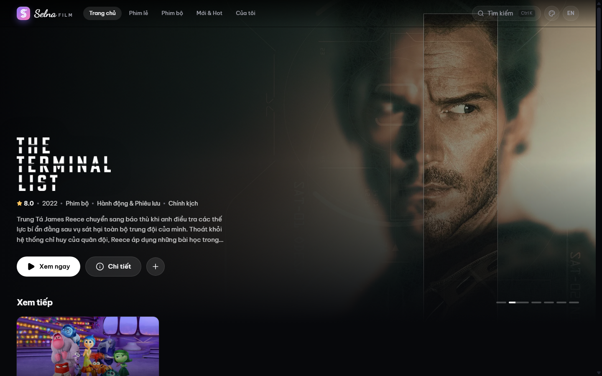
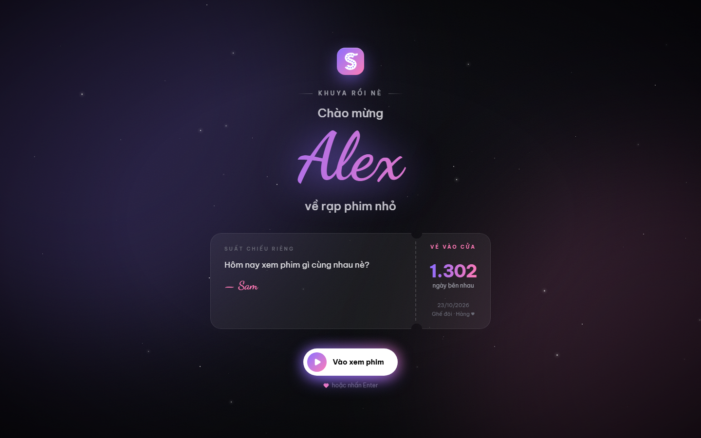
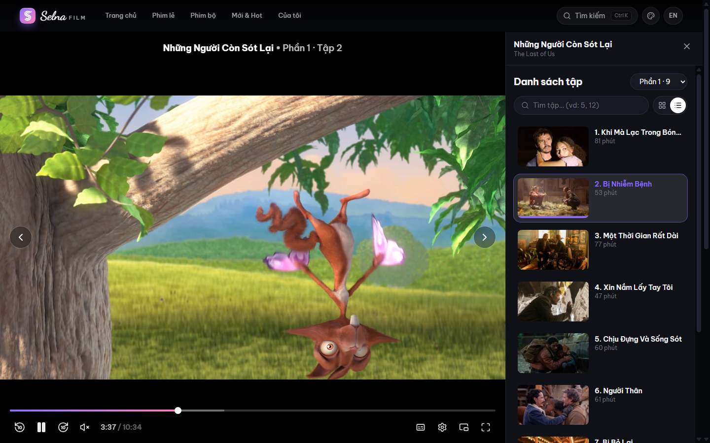
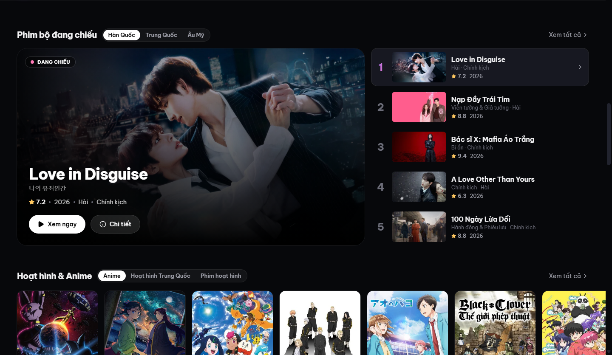
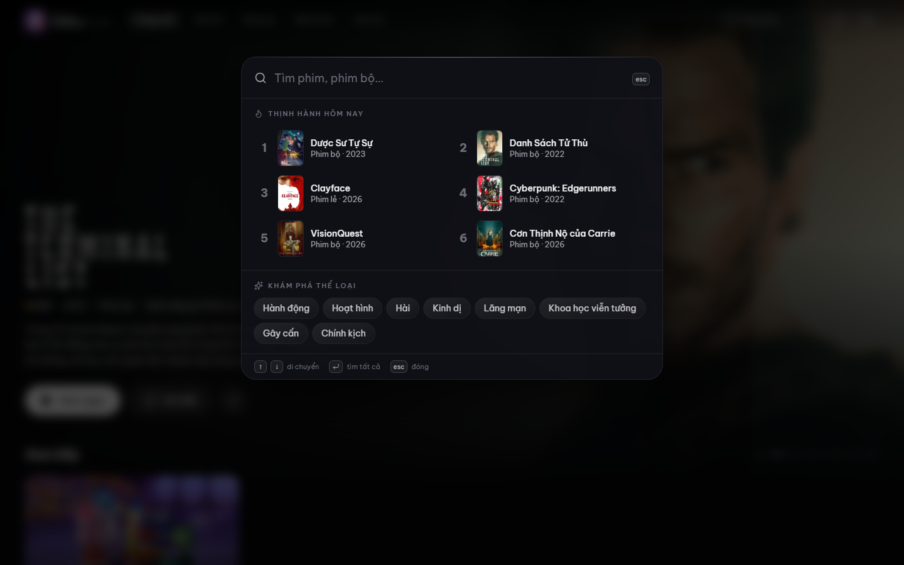
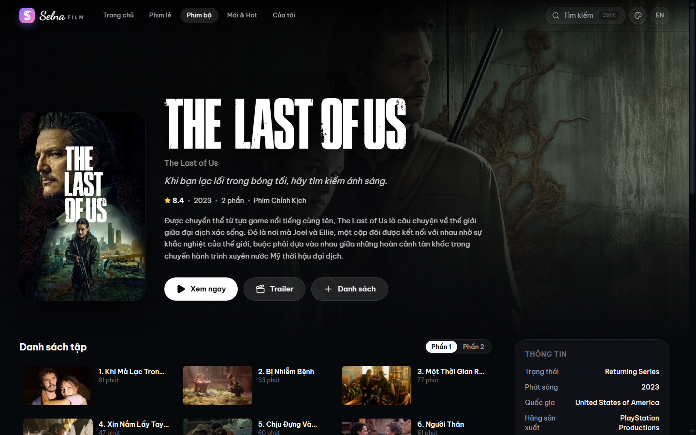
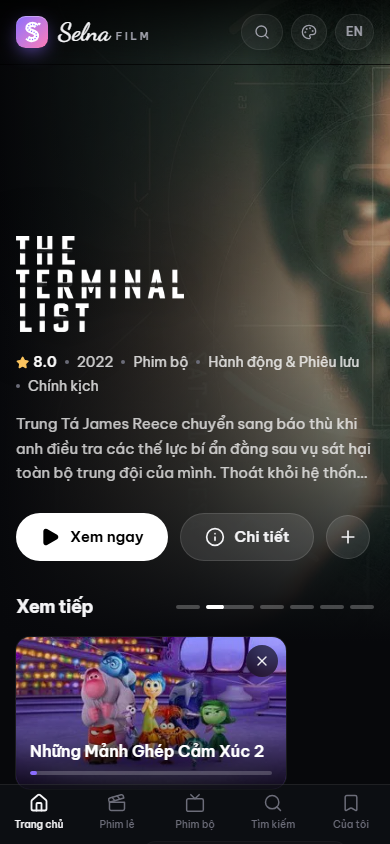
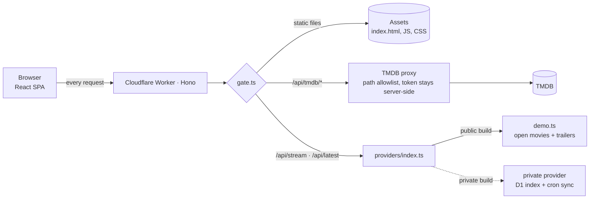

# SelnaFilm

A tiny private cinema for two — a movie & TV streaming web app built as a personal gift, with a
Netflix-style UI, its own HLS player, and a Cloudflare Worker backend that runs entirely on the free tier.

> **Live demo:** _coming soon_
>
> This is the public showcase build. It plays the Blender Foundation's open movies (CC BY 3.0) and
> official trailers instead of the private deployment's stream source, and uses sample personal data.



| Welcome screen | Theater watch page (own HLS player) |
|---|---|
|  |  |

| Series on air now | Search palette (`Ctrl K`) |
|---|---|
|  |  |

| Title details | Mobile |
|---|---|
|  |  |

---

## Features

- **Browse & discover** — hero carousel, a featured "on air now" series beside a top-5 chart per country,
  anime & animation, trending, top 10 of the week; movie/TV catalogues filtered by genre, country and
  sort, with infinite scroll.
- **Watch** — theater layout with a side episode panel (season picker, find-by-number, grid / list view);
  custom HLS player (hls.js, quality & speed menus, ±10 s skip, picture-in-picture, a bar to cover
  burned-in subtitles, keyboard shortcuts, resume position); multiple servers with automatic fallback.
- **Continue watching** like Netflix, **My List**, and "Because you watched / liked …" recommendation rows.
- **Search** — command-palette dialog (`Ctrl K` or `/`) with live suggestions, recent searches and
  recently opened titles, trending today and genre shortcuts, keyboard navigation, plus a full results page.
- **Bilingual** — Vietnamese and English UI (`/vi`, `/en`), localized TMDB metadata, readable titles
  for shows TMDB only knows in their native script.
- **Gift touches** — a welcome screen styled as a private screening (cinema ticket with a "days together"
  counter, curtain-opening exit), special-day greetings with falling hearts, and 8 accent themes.
- Responsive down to phones, with a bottom tab bar and installable home-screen icon.

## Tech stack

| Layer | Tools |
|---|---|
| Frontend | React 19, Vite 7, TypeScript, React Router 7 (lazy routes), TanStack Query 5, Zustand, Tailwind CSS 4 |
| Video | hls.js (lazy-loaded only on the watch page) |
| Backend | Cloudflare Workers + Hono, static assets served by the same Worker |
| Data | TMDB API (proxied), Cloudflare D1 + Cron Triggers (private build) |
| Auth (private build) | IP allowlist with IPv4/IPv6 CIDR, Cloudflare Access (Google sign-in) with JWT verification |

## Architecture



- **One Worker serves everything.** `run_worker_first` sends even the HTML and JS bundles through the
  Worker, so a single gate (`worker/gate.ts`) protects the whole app in the private deployment.
- **Pluggable stream providers.** `worker/providers/types.ts` defines a three-function contract
  (`resolveStreams`, `latestTitles`, `scheduledSync`); this repo ships the demo provider.
- **TMDB never sees the browser.** `/api/tmdb/*` only forwards an allowlisted set of read endpoints
  (`worker/tmdb.ts`), keeps the token in a Worker secret, and merges English titles into localized lists.

## Engineering notes

- **Performance.** Migrated from Next.js to a Vite SPA on Workers. Initial JS is ~136 kB gzip and CSS
  ~13 kB gzip; hls.js (185 kB gzip) loads only when a video plays. Routes are lazy, details are
  prefetched on card hover, images use `srcSet` and fade in once decoded.
- **Access control without a database** (`worker/access.ts`, `worker/ip.ts`). The private deployment lets
  a request in if its IP matches an allowlist (IPv4/IPv6 CIDR parsed with `BigInt`) or it carries a valid
  Cloudflare Access JWT — verified in the Worker against the team's JWKS (audience, issuer, expiry,
  key rotation with a rate-limited refetch), so requests that bypass Access are still refused.
- **Matching streams to TMDB titles.** The private provider indexes a third-party catalogue by TMDB id
  in Cloudflare D1, kept current by a 30-minute cron that reads the source's "recently updated" feed.
  An audit of 400 sampled titles showed title search missed 5% and mis-matched one; the id index brought
  both to zero. Long shows listed as a single entry get the episode number counted across seasons.
- **Edge caching that respects freshness.** API responses are cached at the edge on custom domains, but
  empty results (no source *yet*) are never cached, so new episodes show up on the next visit.
- **No-framework i18n.** Typed message keys (`MessageKey` derived from the JSON), `t(key, vars)`, and
  locale-prefixed links; both locales are kept in sync.
- **Design system.** Tailwind v4 `@theme` tokens (`bg-canvas`, `text-muted`, `accent`…); the accent pair
  is swapped at runtime for the 8 themes, and the logo, glows and welcome screen follow it.

## Getting started

```bash
npm install
cp .dev.vars.example .dev.vars   # add a TMDB read access token (themoviedb.org/settings/api)
npm run dev                      # http://localhost:5173 — SPA + Worker together
```

| Script | What it does |
|---|---|
| `npm run dev` | Vite dev server with the Worker running in `workerd` |
| `npm run build` | Type-check (app, worker, config) and build to `dist/` |
| `npm run preview` | Build and serve the production output locally |
| `npm run deploy` | Build and deploy to Cloudflare (`npx wrangler secret put TMDB_ACCESS_TOKEN` first) |

## Project structure

```
worker/                Cloudflare Worker (Hono)
  index.ts             routes: TMDB proxy, streams, latest, account
  gate.ts              access gate (open in this build)
  access.ts, ip.ts     Cloudflare Access JWT verification, IP / CIDR allowlist
  tmdb.ts              TMDB client with path allowlist and English-title merge
  providers/           stream provider contract + demo provider
src/
  pages/               one file per route (lazy loaded)
  components/          layout, media rows & cards, watch (player), gift, ui
  lib/                 query definitions, media model, genres, countries
  store/               My List, Continue watching, theme (persisted)
  i18n/                vi / en messages
  config/gift.ts       the personal part (sample values here)
```

## Credits

- Movie and TV data from [TMDB](https://www.themoviedb.org/). This product uses the TMDB API but is not
  endorsed or certified by TMDB.
- Demo videos: *Big Buck Bunny* and *Tears of Steel* © Blender Foundation, [CC BY 3.0](https://creativecommons.org/licenses/by/3.0/)
  (peach.blender.org, mango.blender.org); HLS test streams hosted by Mux and Unified Streaming.
- Trailers play from YouTube via `youtube-nocookie.com`.
